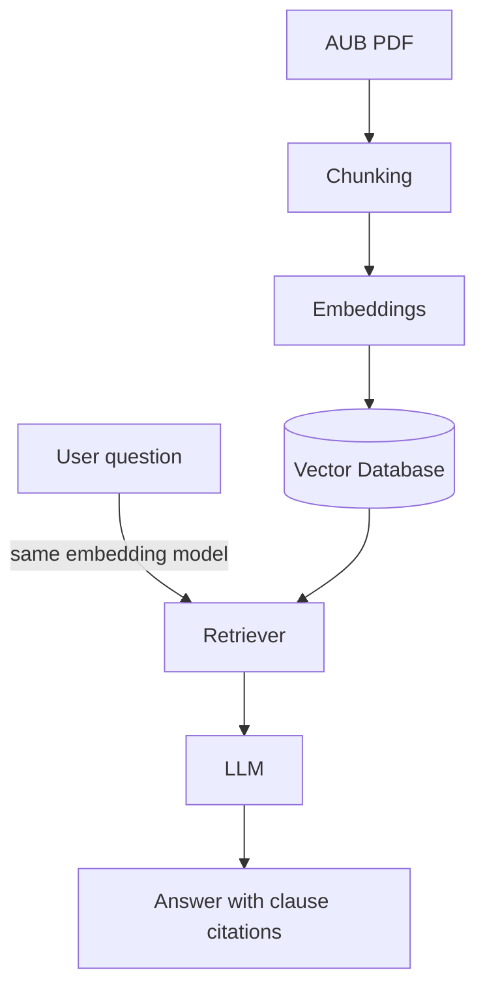

# RAG System for the GDV AUB 2020

A Retrieval-Augmented Generation (RAG) prototype that answers natural-language questions about the **GDV Allgemeine Unfallversicherungsbedingungen (AUB 2020)**. Its answers are grounded in the document's own clauses.

## Project Overview

Insurance terms like the AUB 2020 are long, legally worded and organised in numbered sections and clauses. This project builds a system where users can ask questions in plain language and get answers that:

- are based only on the AUB 2020 document,
- cite the supporting section and clause numbers, and
- say clearly when the document does not contain enough information to answer.

**Provisional research question**

> How effectively can a RAG system answer questions about the GDV AUB 2020 document while grounding its answers in the relevant policy clauses?

## Objectives

1. **Document preparation:** extract the AUB 2020 text and keep its section and clause references.
2. **RAG pipeline:** implement document processing, chunking, embeddings, retrieval and answer generation.
3. **Grounded answers:** return answers with source references, and say so when the document has no answer.
4. **Evaluation:** test the prototype on a small set of questions with manually verified answers. Focus on:
   - answer correctness, and
   - whether the cited passages actually support the answer.

### Initial Scope

- Knowledge source: GDV AUB 2020 only.
- A basic, working RAG pipeline (no advanced optimisation yet).
- A small, manually verified evaluation set.

### Possible Future Extensions

These are not part of the initial objective. They depend on time and resources.

- Compare conventional RAG with GraphRAG.
- Evaluate different language models (different sizes, multilingual capabilities).
- Add further insurance policy documents.

## Architecture



- **Indexing (runs once):** AUB PDF → Chunking → Embeddings → Vector Database
- **Querying (runs per question):** the question is embedded with the same model, the retriever finds the most similar clauses, and the LLM writes an answer from them.

## Team Members

| Name | GitHub |
| --- | --- |
| Sujan Karna | [@SujanKarna](https://github.com/SujanKarna) |
| Meeta Dave | [@davemeeta](https://github.com/davemeeta) |
| Hein Naing Soe | [@HeinNS](https://github.com/HeinNS) |
| Kyi Phyu Shin | [@ClariceKyi](https://github.com/ClariceKyi) |

## Technology Stack

> _Placeholder: to be decided._

| Component | Tool / Library |
| --- | --- |
| Language | _TBD_ |
| Document extraction | _TBD_ |
| Chunking | _TBD_ |
| Embedding model | _TBD_ |
| Vector database | _TBD_ |
| LLM | _TBD_ |
| Evaluation | _TBD_ |

## Setup Instructions

> _Placeholder: will be added once the tech stack is finalised._

```bash
# 1. Clone the repository
git clone https://github.com/SujanKarna/rag-aub2020-insurance-assistant.git
cd rag-aub2020-insurance-assistant

# 2. Create environment and install dependencies
# TBD

# 3. Place the AUB 2020 PDF in documents/
# TBD

# 4. Run the pipeline
# TBD
```

## Repository Structure

```text
rag-aub2020-insurance-assistant/
├── documents/    # Source document: the AUB 2020 PDF
├── data/         # Extracted text and chunks with clause metadata
├── embeddings/   # Saved vectors / vector database files
├── src/          # Pipeline code: extraction, chunking, embedding, retrieval, generation
├── notebooks/    # Jupyter notebooks for experiments
├── tests/        # Evaluation questions and tests
├── results/      # Evaluation outputs and answer logs
├── docs/         # Project documentation and diagrams
├── LICENSE
└── README.md
```
